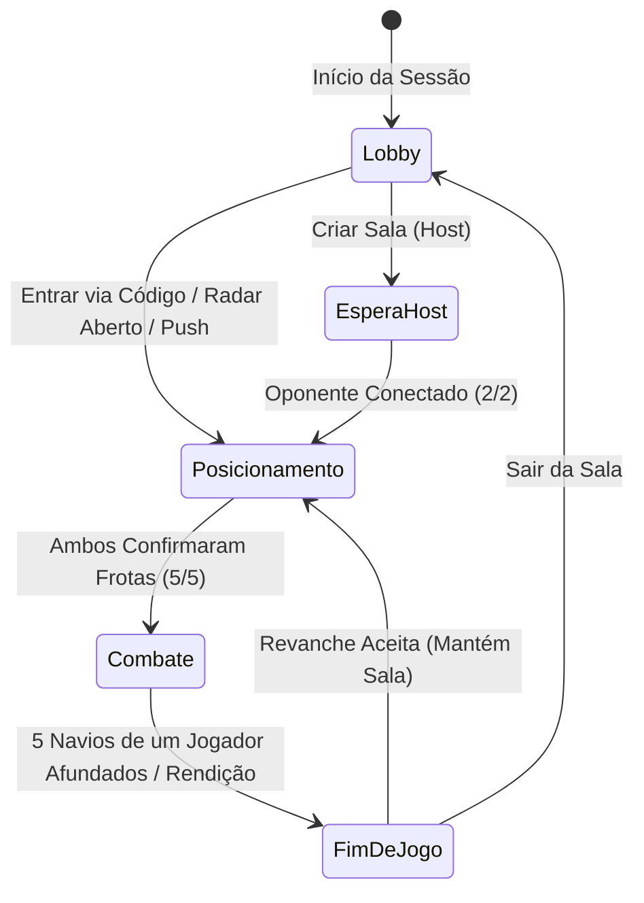

# ⚓ Manual de Funcionamento e Regras: Batalha Naval High-Tech

Este documento descreve detalhadamente o funcionamento, regras clássicas, mecânicas táticas e a arquitetura técnica da implementação do jogo **Batalha Naval High-Tech** (*Tactical Cyber Command*).

---

## 🎯 1. Visão Geral e Objetivo

A **Batalha Naval** (*Battleship*) é um jogo militar de estratégia, dedução e adivinhação em turnos para dois jogadores. Cada participante atua como comandante de uma esquadra naval em um setor de combate oculto.

- **Objetivo Principal:** Localizar e afundar todos os 5 navios da esquadra adversária antes que a sua própria esquadra seja destruída.
- **Formato:** Tabuleiro 10×10 (100 coordenadas de tiro).
- **Total de Alvos:** 17 células ocupadas por jogador.

---

## 🚢 2. As Frotas e o Tabuleiro Regulamentar

O confronto ocorre em uma malha ortogonal de coordenadas bidimensionais:
- **Linhas:** `A` a `J` (ou índices `0` a `9`).
- **Colunas:** `1` a `10` (ou índices `0` a `9`).

Cada comandante dispõe de **5 navios oficiais regulamentares**, com dimensões e propriedades fixas:

| Ícone | Embarcação | Células | Descrição Tática |
| :---: | :--- | :---: | :--- |
| 🚢 | **Porta-Aviões** | **5** | Maior navio da frota; ocupa metade de uma linha ou coluna inteira. |
| ⚔️ | **Encouraçado** | **4** | Navio de guerra pesado de alta resistência. |
| 🛡️ | **Cruzador** | **3** | Embarcação de porte médio ágil e versátil. |
| 🌊 | **Submarino** | **3** | Unidade submersível furtiva de 3 células. |
| ⚡ | **Contratorpedeiro** | **2** | Menor navio da frota; o mais difícil de localizar no radar. |

### Regras Geométricas de Alocação:
1. **Alinhamento Contínuo:** Todo navio deve ser alocado exclusivamente em linha reta contínua, na orientação **Horizontal** ou **Vertical**.
2. **Proibição de Diagonais:** É estritamente proibido posicionar navios em diagonal ou em formato curvo/fragmentado.
3. **Não-Sobreposição:** Duas embarcações não podem ocupar a mesma célula do tabuleiro.
4. **Limites do Radar:** Nenhuma parte da embarcação pode extrapolar os limites do tabuleiro (coordenadas fora do intervalo 0–9).

---

## 🔄 3. Ciclo de Vida da Partida e Máquina de Estados

O ciclo de uma partida no sistema segue uma máquina de estados bem definida:

### 3.1. Fase de Lobby e Pareamento
1. **Salas Públicas no Radar:** Partidas configuradas como públicas entram em transmissão aberta via WebSockets (`public_rooms_updated`) para qualquer visitante do Lobby.
2. **Salas Privadas via Código ou QR Code:** Geração de código alfanumérico de 4 caracteres (ex: `A8K2`) e QR Code dinâmico para leitura imediata pela câmera de outro smartphone na mesma rede ou via domínio público.
3. **Desafio Push de Amigos:** Jogadores amigos mútuos (`CMD-XXXX`) podem disparar uma notificação push direta para o celular do oponente com o link da sala.

### 3.2. Fase Estratégica de Posicionamento (*Fleet Placement*)
- Os jogadores operam seus tabuleiros de forma independente e simultânea, sem que o adversário veja a tela.
- Recursos disponíveis:
  - Seleção por chips de cada embarcação.
  - Alternância de rotação entre Horizontal (`H`) e Vertical (`V`).
  - Posicionamento automático inteligente (`🎲 Auto`).
  - Limpeza total do tabuleiro (`🗑️ Limpar`).
- **Confirmação:** O botão `⚓ Pronto (X/5)` só é habilitado após a validação bem-sucedida das 5 embarcações.
- Quando ambos os jogadores confirmam, o servidor inicia automaticamente a fase de combate.

### 3.3. Fase de Combate e Disparos (*Battle Radar*)
1. **Sorteio do Primeiro Turno:** O servidor sorteia aleatoriamente qual comandante inicia atacando (50% de chance para cada).
2. **Alternância entre Ataque e Defesa:**
   - **Aba de Ataque:** Visualização do radar inimigo para mira e lançamento de mísseis. Células não exploradas podem ser bombardeadas.
   - **Aba de Defesa:** Visualização da própria frota, indicando os locais intactos e os navios que sofreram danos.
3. **Mecânica de Tiro Extra:**
   - **💥 Acertou (Hit):** Se o disparo atingir qualquer célula contendo um navio inimigo, a célula é marcada em vermelho e o jogador **recebe imediatamente direito a um novo disparo no mesmo turno**.
   - **🌊 Água (Miss):** Se o míssil atingir água vazia, a coordenada é registrada em tom azul-cinza e a vez de disparar passa para o adversário.
4. **Afundamento de Navio (*Sunk*):**
   - Quando todas as células de uma embarcação específica forem alvejadas, o servidor declara o navio afundado (`sunk: true`).
   - O nome e tamanho do navio destruído são anunciados a ambos os jogadores e a silhueta correspondente no marcador de frota é tachada.
5. **Bloqueio de Radar:** Durante o turno adversário, o radar de ataque do jogador receptor permanece bloqueado visualmente para evitar toques acidentais.

### 3.4. Fase de Fim de Jogo e Revanche
- **Vitória por Destruição:** Ocorre no instante em que o 5º navio adversário for afundado (17 células atingidas).
- **Vitória por Rendição (*Forfeit*):** Se um dos jogadores fechar a página ou clicar no botão de rendição, o outro é declarado vitorioso imediatamente.
- **Revelação de Frotas:** Com o jogo encerrado, os navios restantes do adversário são revelados no tabuleiro para auditoria e transparência.
- **Estatísticas e Ranking:** Disparos totais, acertos e taxa de precisão (%) são calculados e registrados no ranking persistente.
- **Revanche Rápida:** Ambos os jogadores podem concordar em reiniciar a partida mantendo a mesma sala e acumulando o placar da sessão (`Você X ⚔️ Y Oponente`).

---

## 🛡️ 4. Arquitetura Técnica e Segurança Anti-Cheat

### 4.1. Blindagem de Dados no Servidor (`server.js`)
Para impedir trapaças via DevTools, extensões de navegador ou inspeção de pacotes:
- **Zero-Knowledge no Cliente:** As coordenadas exatas dos navios adversários ficam guardadas unicamente na memória interna do servidor Node.js.
- O cliente só é informado das coordenadas de um navio no momento em que ele é efetivamente afundado ou quando a partida termina.
- **Validação Rigorosa de Ações:** O servidor rejeita qualquer disparo fora do turno ativo, disparos em coordenadas duplicadas ou posições inválidas.

### 4.2. Protocolo WebSocket (Mensagens e Eventos)

| Evento | Origem | Finalidade |
| :--- | :---: | :--- |
| `create_room` | Cliente $\rightarrow$ Servidor | Cria nova sala (pública ou privada) e gera código. |
| `join_room` | Cliente $\rightarrow$ Servidor | Segundo jogador ingressa na sala pelo código. |
| `start_placement` | Servidor $\rightarrow$ Clientes | Transição para a tela de alocação de navios. |
| `submit_fleet` | Cliente $\rightarrow$ Servidor | Envia a configuração da frota para validação. |
| `battle_started` | Servidor $\rightarrow$ Clientes | Notifica o início do combate e quem tem a vez inicial. |
| `fire` | Cliente $\rightarrow$ Servidor | Dispara míssil nas coordenadas `{ row, col }`. |
| `shot_result` | Servidor $\rightarrow$ Clientes | Retorna resultado `{ isHit, sunkShip, isYourTurn }`. |
| `game_over` | Servidor $\rightarrow$ Clientes | Declara vencedor, estatísticas e frota revelada. |
| `request_rematch` | Cliente $\rightarrow$ Servidor | Solicita reinício de partida aos comandantes. |
| `surrender` | Cliente $\rightarrow$ Servidor | Jogador abandona o combate concedendo a vitória. |

---

## 🔊 5. Efeitos Sonoros Procedurais e Resposta Háptica

O projeto utiliza tecnologias web nativas sem downloads de mídias pesadas:
- **Web Audio API (`audio.js`):** Síntese procedural de frequências sonoras em tempo real (clique tático, ping de sonar, zumbido de míssil, explosão grave com ruído branco e fanfarra de vitória).
- **Vibração Háptica (`haptics.js`):** Padrões vibratórios via `navigator.vibrate` sincronizados com os eventos de acerto, erro e perda de navios em celulares Android.

---

## 🏆 6. Sistema de Classificação e Estatísticas (Janela de 7 Dias)

As estatísticas são salvas no banco de dados (`data/leaderboard.json`) com uma política estrita de **retenção rolante de 7 dias** e **expurgo diário automatizado**:
- **Janela Rolante de 7 Dias:** Somente partidas disputadas nos últimos 7 dias contam para o ranking de comandantes.
- **Expurgo Diário Automatizado:** Rotina programada executada à meia-noite (e a cada 24 horas, além de checagem na inicialização) descarta partidas com mais de 7 dias e remove comandantes inativos sem partidas recentes.
- **Métricas Avaliadas:**
  - **Vitórias e Derrotas no Período (7 dias).**
  - **Taxa de Vitória (% Win Rate):** Percentual de jogos vencidos sobre o total de partidas nos últimos 7 dias.
  - **Precisão de Disparos (% Accuracy):**
    $$\text{Precisão} = \left(\frac{\text{Total de Tiros Certeiros}}{\text{Total de Tiros Disparados}}\right) \times 100$$

A tabela de líderes exibe condecorações militares para os melhores colocados (🥇, 🥈, 🥉) e destaca a linha do jogador logado.

---

## 🧠 7. Principais Estratégias de Jogo

1. **Varredura por Paridade (Padrão Xadrez):**
   - Como a menor embarcação (Contratorpedeiro) tem 2 células, é matematicamente impossível ela se esconder sem ocupar ao menos uma casa em um padrão intercalado de tabuleiro de xadrez.
   - Atirar apenas onde `(linha + coluna) % 2 === 0` reduz o espaço de busca pela metade.
2. **Modo Caçar e Destruir (*Hunt & Target*):**
   - Dispare em padrão esparso até registrar o primeiro acerto (`💥`).
   - Imediatamente teste as 4 casas adjacentes (norte, sul, leste, oeste).
   - Ao encontrar a direção do navio, continue disparando nessa linha até que o navio seja afundado antes de retomar a busca geral.
3. **Dispersão e Assimetria de Defesa:**
   - Evite colar navios paralelamente; isso reduz a chance de o adversário acertar um segundo navio por engano enquanto tenta afundar o primeiro.
   - Combine posições nas bordas e cantos com posições centrais para dificultar o padrão de busca do oponente.
