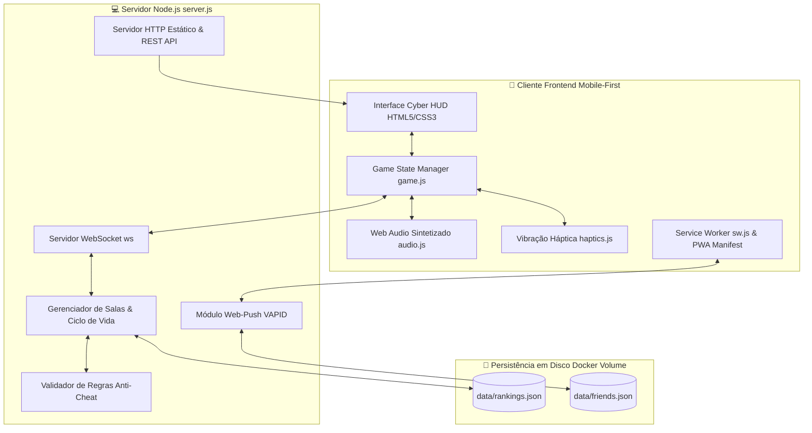
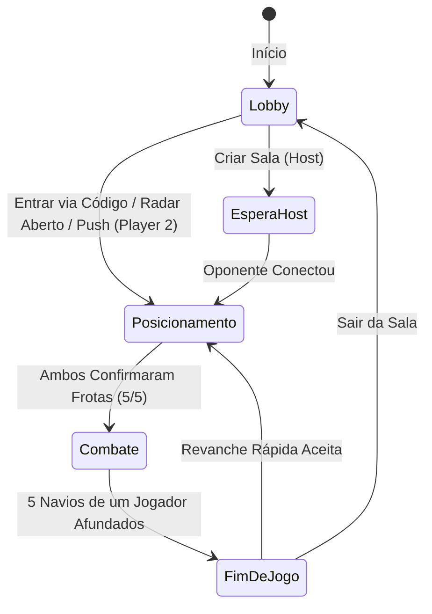

# ⚓ Batalha Naval High-Tech — Plano Completo de Jogo Web Mobile

Documento mestre de especificação de produto, arquitetura de software, design de interação e sistemas de jogo para o **Batalha Naval High-Tech** (*Tactical Cyber Command*).

---

## 🎯 1. Visão Geral do Produto

| Atributo | Descrição |
| :--- | :--- |
| **Gênero** | Batalha Naval Tática Multiplayer em Tempo Real (*Battleship*) |
| **Público-Alvo** | Jogadores casuais e competitivos em smartphones e desktops |
| **Plataforma** | Web Mobile-First, Progressive Web App (PWA) instalável (iOS, Android, Windows, Mac, Linux) |
| **Estética Visual** | *Cyber Tactical Command* — Sala de operações militares futurista, neon cyan/verde, tema escuro e radar tático |
| **Conexão** | WebSockets de baixa latência em tempo real, QR Code e pareamento por código de 4 caracteres |
| **Áudio & Tato** | Web Audio API sintetizada (zero download de áudio) + vibração háptica tática (`navigator.vibrate`) |
| **Deploy Oficial** | Produção em nuvem ARM64 com HTTPS e Docker: `https://batalha.bolsadedados.com.br` |

---

## 🏗️ 2. Arquitetura Técnica do Sistema

### 2.1. Backend (Node.js Vanilla + WebSockets)
- **Zero Frameworks Pesados:** Construído em Node.js com biblioteca nativa `ws` para consumo mínimo de memória RAM e CPU.
- **Validação Anti-Cheat Severa:** As posições das frotas adversárias são mantidas exclusivamente no servidor. Nenhuma coordenada de navio oculto é enviada ao cliente antes de ser atingida e destruída.
- **Auto-Detecção de IP de Rede Local:** O servidor escaneia interfaces de rede (`os.networkInterfaces`) para gerar links e QR Codes que funcionam instantaneamente na rede Wi-Fi local ou via domínio público.
- **Volume Docker Persistente:** Diretório `/app/data` montado com volume mapeado para manter ranking e amigos mesmo após recriação de containers.

### 2.2. Frontend (Vanilla JS Modular & Zero-Overhead)
- **Performance Extrema:** 100% Vanilla JS e CSS moderno sem dependências de bundle (Webpack/Vite desnecessários), permitindo carregamento instantâneo em conexões móveis 3G/4G.
- **Service Worker (`sw.js`):** Cache de assets estáticos offline e escuta de eventos `push` para exibição de notificações do sistema operacional.

---

## 🎨 3. Design System & UI/UX Mobile-First

Baseado nas regras e métricas do **UI/UX Pro Max**:

### 3.1. Paleta de Cores Tática (Tokens Semânticos)
- `--bg-dark`: `#040811` (Preto abissal naval)
- `--bg-card`: `#091222` (Placa militar de comando)
- `--bg-surface`: `#0f1c33` (Superfície metálica elevada)
- `--cyan`: `#00f0ff` (Radar ativo, mira e navegação)
- `--green-tactical`: `#00ffaa` (Pronto, confirmação, vitória)
- `--red-danger`: `#ff2a55` (Impacto de míssil, fogo, dano crítico)
- `--orange-warn`: `#ffaa00` (Alerta de espera, pendências)
- `--blue-water`: `#143257` (Água não explorada na grade)
- `--blue-miss`: `#39638f` (Disparo que errou o alvo / água)

### 3.2. Ergonomia & Regras de Interação Mobile
1. **Zero-Scroll em Telas Ativas:** As telas de *Posicionamento de Frota* e *Combate de Radar* são projetadas para caber 100% no viewport de celulares pequenos (a partir de 360px de largura) sem rolagem vertical desnecessária.
2. **Touch Targets Seguros:** Todos os botões e áreas clicáveis possuem dimensões mínimas de 42×42px a 48×48px.
3. **Safe Area Insets:** Suporte a `env(safe-area-inset-top)` e `env(safe-area-inset-bottom)` para evitar sobreposição em entalhes (notches), Dynamic Island e barras de gestos do iOS e Android.
4. **Microcópia Concisa:** Textos diretos ao ponto, eliminando parágrafos longos em favor de feedback visual e sonoro imediato.
5. **Feedback Tátil Imediato:** Microinteração ativa com `transform: scale(0.97)` e `touch-action: manipulation` eliminando qualquer atraso de 300ms nos cliques.

---

## 🎮 4. Mapeamento Completo de Recursos e Telas

---

### 4.1. HUD Global Superior
- **Barra de Comando Fixa:**
  - Identidade visual militar: `⚓ Batalha Naval`.
  - Ações rápidas com touch target otimizado:
    - `👥 Amigos`: Abre o painel social e de desafios push.
    - `🏆 Ranking`: Abre o quadro de honra global de vitórias.
    - `📲 Instalar`: Abre o instalador do PWA e instruções.
    - `🔊/🔇 Som`: Alterna áudio em tempo real com aviso dedicado ao iPhone (chave silenciosa).
- **Banner de Turno Contextual:**
  - Permanece oculto durante o Lobby para não consumir espaço de tela.
  - Ativa-se exclusivamente durante a batalha informando o turno (`🟢 SUA VEZ!`, `💥 TIRO EXTRA!`, `⏳ TURNO: [NOME]`).

---

### 4.2. Tela 1: Lobby & Radar de Batalhas
- **Identificação do Jogador:** Campo personalizável com persistência no `localStorage` (`naval_player_name`).
- **Seletor de Privacidade:**
  - **Pública 🌐 (Padrão):** A partida entra no radar público e qualquer visitante do site pode entrar com 1 toque.
  - **Privada 🔒:** Sala invisível no radar, acessível apenas por código direto, QR Code ou desafio push de amigos.
- **Botão Primário:** `Criar Sala 📡`.
- **Radar de Batalhas em Aberto:**
  - Painel de telemetria ao vivo com sinalizador pulsante (`.radar-live-blip`).
  - Lista de salas abertas aguardando oponente em tempo real via WebSocket (`public_rooms_updated`) e polling suave.
  - Exibe nome do comandante, código da sala, tempo de espera (*agora mesmo*, *há 15s*) e botão de acesso direto `Entrar ⚡`.
  - Remoção automática assim que o segundo jogador entra ou se o host fechar o navegador.
- **Entrada Rápida por Código:** Linha única integrada contendo campo de código (com auto-capitalização) e botão `Entrar ⚡`.
- **Ações Rápidas de Acesso:** Botões compactos para abrir Amigos e Ranking.

---

### 4.3. Tela 2: Sala de Espera (Host & QR Code)
- **Código Tático da Sala:** Destaque em tipografia militar com botão de toque para copiar para a área de transferência.
- **Etiqueta de Privacidade:** Indicador visual confirmando se a sala está pública no radar ou privada.
- **QR Code Dinâmico:** Gerado no canvas/imagem para que o segundo jogador aponte a câmera do celular e ingresse instantaneamente.
- **Endereço de Conexão:** Exibição da URL direta de compartilhamento e botão `📋 Copiar Link`.

---

### 4.4. Tela 3: Fase Estratégica de Posicionamento de Frotas
- **Navios Oficiais Regulamentares:**
  1. Porta-Aviões (5 células) `🚢`
  2. Encouraçado (4 células) `⚔️`
  3. Cruzador (3 células) `🛡️`
  4. Submarino (3 células) `🌊`
  5. Contratorpedeiro (2 células) `⚡`
- **Seletor de Navios:** Chips deslizantes com ícone, nome, tamanho e indicador de confirmação (`✓`) após alocação.
- **Orientação:** Botão de alternância instantânea entre Horizontal (`H`) e Vertical (`V`).
- **Grade 10×10 Interativa:**
  - Coordenadas de A-J e 1-10.
  - Preview dinâmico de células ao tocar ou arrastar (verde para alocação válida, vermelho para sobreposição ou limite do tabuleiro).
- **Ações Táticas na Zona do Polegar:**
  - `🔄 Girar`: Alterna orientação do navio ativo.
  - `🎲 Auto`: Posiciona toda a frota de forma aleatória e inteligente em milissegundos.
  - `🗑️ Limpar`: Reseta o tabuleiro.
  - `⚓ Pronto (X/5)`: Botão de confirmação com validação estrita (habilita apenas com os 5 navios posicionados sem erros).

---

### 4.5. Tela 4: Fase de Combate (Radar Militar em Tempo Real)
- **Barra de Confronto Direto da Sessão:** Placar de partidas jogadas na sala (`Você 0 ⚔️ 0 Inimigo`), persistido enquanto a sala estiver ativa.
- **Sistema de Abas de Combate:**
  - `🎯 Aba Ataque`: Radar tático inimigo para mira e lançamento de mísseis.
  - `🛡️ Aba Defesa`: Visualização da própria frota, equipada com badge de alerta vermelho (`!`) pulsante quando o adversário dispara.
- **Rastreador de Frotas (Pips Silhuetas):**
  - Mostra as 5 embarcações aliadas e inimigas.
  - Quando um navio é destruído, o pip é automaticamente tachado (`.sunk`), diminuindo a opacidade e mudando para vermelho de afundamento.
- **Mecânica de Tiro Extra:**
  - Ao atingir uma coordenada com navio inimigo (`💥 ACERTOU`), o jogador ganha imediatamente o direito a mais um disparo no mesmo turno.
  - Ao atingir água (`🌊 ÁGUA`), a vez de disparar passa para o adversário.
- **Radar Locked:** Trava tática visual no radar quando não é a vez do jogador atirar, impedindo cliques errôneos.
- **Splash Overlay de Turno:** Anúncio visual imersivo e sonoro ao trocar a vez do jogador.

---

### 4.6. Tela 5: Fim de Jogo & Revanche Rápida
- **Modal Temático de Desfecho:**
  - **Vitória:** Borda verde neon, som de fanfarra e vibração triunfal.
  - **Derrota:** Borda vermelha de alarme e som fúnebre.
- **Estatísticas Completas da Partida:**
  - Total de Tiros Disparados.
  - Tiros Certeiros.
  - Taxa de Precisão de Mísseis (%).
- **Placar da Sessão Atualizado:** Placar acumulado do confronto entre os dois comandantes.
- **Revanche Rápida (`🔄 Revanche Rápida`):** Ambos os jogadores podem reiniciar uma nova partida mantendo a sala, sem precisar gerar novos links ou QR codes.
- **Botão `⭐ +Amigo`:** Adiciona o oponente aos amigos diretamente da tela de fim de jogo com 1 clique.

---

## 👥 5. Sistema Social de Amigos & Desafios Web Push

### 5.1. Código de Comandante Único
- Ao entrar pela primeira vez, o servidor gera e atribui um código tático de comandante (ex: `CMD-7X9Y`), persistido em `localStorage` e sincronizado na rota `/api/player/sync`.

### 5.2. Amizade com Validação Mútua
- Um jogador adiciona o outro inserindo o código ou através de link de compartilhamento (`?amigo=CMD-XXXX`).
- O sistema distingue dois estados:
  - **Pendente:** O Comandante A adicionou B, mas B ainda não adicionou A.
  - **Amigos Mútuos:** Ambos se adicionaram mutuamente.

### 5.3. Desafios via Web Push (VAPID) Anti-Spam
- **Regra de Segurança Estrita:** Apenas amigos mútuos podem disparar chamados de partida via push. Tentativas de disparar push para não-amigos retornam `403 Forbidden`.
- **Disparo de Convite:** O desafiante clica em `Desafiar ⚔️`, o servidor gera uma nova sala e envia um push payload com título, mensagem tática e link direto com parâmetro `?sala=CODE&desafio=1`.
- Ao tocar na notificação no celular, o navegador abre diretamente na sala criada com alerta de desafio recebido.

---

## 🏆 6. Quadro de Honra & Ranking Global

- **Métricas Rastreadas:**
  - Vitórias totais.
  - Derrotas totais.
  - Taxa de Vitória (`% de vitórias sobre partidas totais`).
  - Precisão de Disparos (`% de mísseis que acertaram navios`).
- **Persistência em Disco:** Salvo automaticamente em `data/rankings.json`.
- **Quadro Responsivo:** A tabela exibe medalhas para o top 3 (`🥇`, `🥈`, `🥉`) e destaca a linha do próprio jogador ativo (`(Você)`), ajustando colunas para caber perfeitamente no mobile.

---

## 🔔 7. Popup Integrado de Instalação (PWA) & Push

- **Experiência Completa no Celular:** Modal popup com layout em cartão duplo para promover recursos de app nativo.
  1. **Card 1 (App na Tela Inicial):** Dispara o prompt nativo do PWA no Android/Chrome ou abre o passo a passo ilustrado do Safari no iOS.
  2. **Card 2 (Alertas de Batalha):** Solicita a permissão do navegador para notificações push.
- **Gatilho Inteligente:** Surge suavemente no Lobby após 2.2 segundos para novos usuários, respeitando um intervalo (cooldown) de 24 horas no `localStorage` caso dispensado.
- **Acesso Manual:** Pode ser aberto a qualquer momento pelo botão do topo `📲 Instalar`.

---

## 🔊 8. Motor de Efeitos Sonoros & Hápticos

Toda a sonoplastia é sintetizada proceduralmente via **Web Audio API** no arquivo `audio.js`, sem carregar nenhum arquivo MP3 ou WAV pela rede:

| Efeito Sonoro | Síntese de Áudio | Padrão Háptico (Vibração) |
| :--- | :--- | :--- |
| **Clique Tático** | Pulso senoidal de 800Hz $\rightarrow$ 400Hz (30ms) | `vibrate(10ms)` |
| **Sonar Ping** | Ressonância senoidal de 1200Hz com decay exponencial | `vibrate([30ms, 50ms, 30ms])` |
| **Disparo de Míssil** | Ruído branco modulado com sweep de frequência descendente | `vibrate(40ms)` |
| **Explosão (Acerto)** | Ruído branco de baixa frequência com distorção grave | `vibrate([80ms, 40ms, 120ms])` |
| **Água (Erro)** | Modulação senoidal filtrada simulando splash de água | `vibrate(20ms)` |
| **Navio Afundado** | Sirene oscilante militar de alerta crítico de destruição | `vibrate([150ms, 80ms, 250ms])` |
| **Alerta de Turno** | Arpejo duplo senoidal de atenção | `vibrate([50ms, 30ms, 50ms])` |
| **Vitória Naval** | Fanfarra triunfante em tríade maior (C-E-G-C) | Padrão rítmico comemorativo |
| **Derrota Naval** | Tons menores descendentes com reverberação grave | Pulso longo grave de derrota |

---

## 🛡️ 9. Matriz de Segurança, Conectividade e Anti-Cheat

| Vetor de Risco | Mitigação Implementada |
| :--- | :--- |
| **Inspeção de Elementos / DevTools** | Coordenadas dos navios ficam apenas na memória do servidor Node.js. O cliente só recebe `{ isHit, sunkShip }` após disparar. |
| **Cliques fora de turno** | Validação server-side descarta e rejeita comandos de tiro se `activePlayer !== socket.id`. |
| **Tiros repetidos** | Células já alvejadas são registradas na matriz do servidor e disparos repetidos são invalidados. |
| **Spam de Desafios Push** | Apenas conexões que possuem código de amizade mútuo registrado em `friends.json` conseguem disparar push. |
| **Desconexão de Jogadores** | Detecção via `ws.on('close')`, remoção imediata da listagem de salas públicas e notificação de perda de sinal ao adversário. |

---

## 📋 10. Checklist de Qualidade UI/UX Pro Max (Status de Entrega)

- [x] **Acessibilidade:** Cores com contraste superior a 4.5:1, `aria-label` em botões de ícones e inputs identificados.
- [x] **Touch Targets:** Mínimo de 42×42px para todos os alvos táteis em smartphones.
- [x] **Safe Areas:** Conformidade com entalhes e gestos de navegação de iOS e Android via CSS `env()`.
- [x] **Zero-Scroll:** Posicionamento e combate cabem inteiramente na tela sem exigir rolagem vertical.
- [x] **Performance:** Tempo de carregamento inferior a 1 segundo, zero dependência de frameworks ou áudios pesados.
- [x] **Resiliência de Dados:** Rankings e redes de amigos persistidos com segurança em volume Docker.
- [x] **PWA & Push:** Instalável como aplicativo de tela cheia com notificações push ativas no Android e iOS.
- [x] **Produção:** Deploy ativo e testado em `https://batalha.bolsadedados.com.br`.
